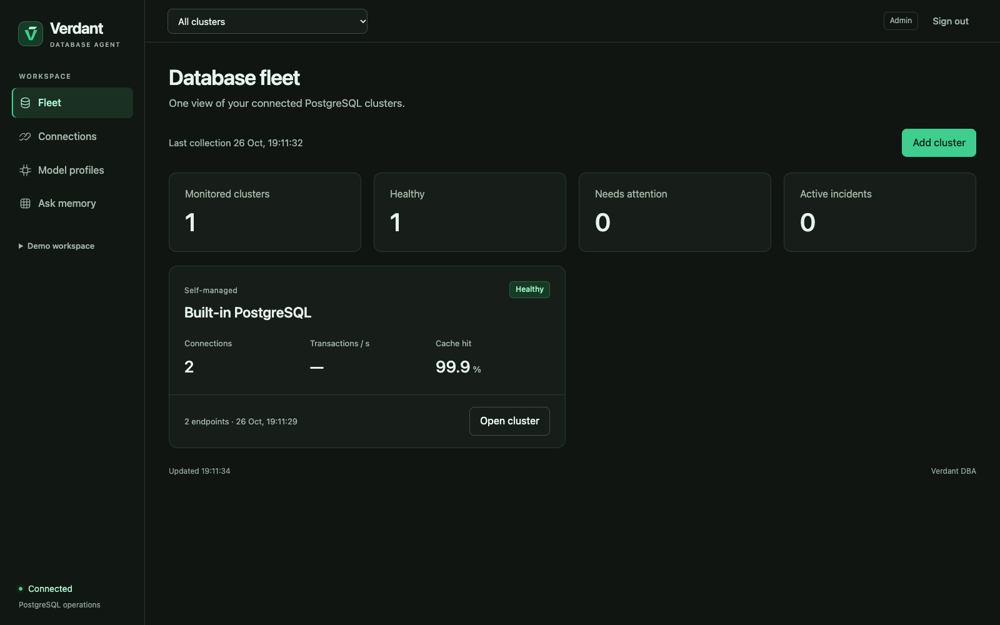
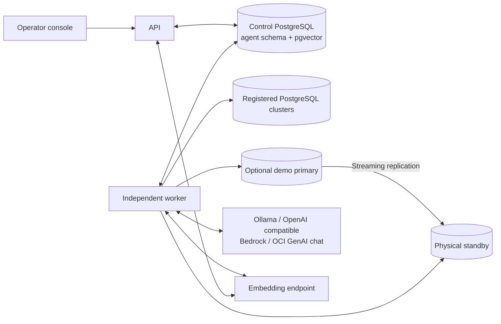
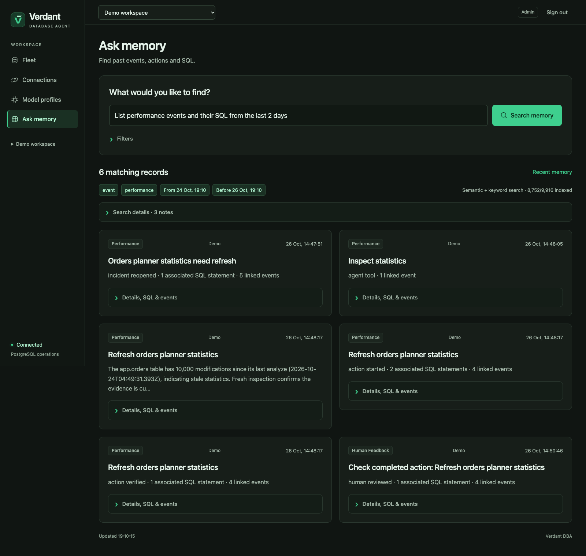

# Verdant DBA

**A supervised autonomous DBA for PostgreSQL, with durable memory and a clear operator console.**

[](https://github.com/shadabshaukat/verdant-ai/actions/workflows/ci.yml)
[](LICENSE)
[](https://nodejs.org/)
[](https://www.postgresql.org/)

Verdant monitors a fleet of PostgreSQL clusters, retains operational memory, and gives operators an aggregate dashboard and a focused view of each cluster. Add self-managed or cloud PostgreSQL endpoints and local or remote chat models from the GUI. Operators steer priorities, approve bounded maintenance, and leave feedback retained in PostgreSQL.

The optional conference deployment includes real streaming replication and five controlled scenarios. A separate production deployment mode runs the control plane without scenario databases. Both use a PostgreSQL control store, encrypted connection credentials, pgvector retrieval and the same Node commands on macOS, Linux and Windows with Docker Linux containers.



[Quick start](#quick-start) · [Configuration](#configuration) · [Architecture](#architecture) · [Memory and search](#memory-and-search) · [Upgrades](#upgrades-and-migrations) · [Contributing](CONTRIBUTING.md)

## What you can do

- **Observe continuously:** primary availability, standby streaming/replay state, WAL byte distance, statistics, blocking relationships, query fingerprints and role privileges.
- **Manage a fleet:** onboard clusters and replicas, test connections, generate least-privilege setup SQL and switch between fleet and cluster dashboards.
- **Inspect deeper metrics:** connection pressure, transaction rates, cache behavior, database growth, blocking, vacuum/table/index statistics and optional `pg_stat_statements` rankings, with capability and sample-age indicators.
- **Choose your chat provider:** configure and test Ollama, OpenAI-compatible APIs, Amazon Bedrock or OCI Generative AI from the console. Embeddings remain separately configured.
- **Investigate with tools:** a local model chooses typed inspections and consumes the actual results.
- **Remediate within policy:** refresh one table's statistics, resume the reference standby, terminate the specifically tagged blocker, revoke a fixed role privilege, or create a fixed index.
- **Supervise decisions:** pause actions, change instructions, require approval, inspect evidence and acknowledge outcomes.
- **Retain operational memory:** store findings, action receipts, human reviews and feedback in PostgreSQL.
- **Search the history:** combine dates, literal keywords, full-text matching and semantic retrieval with linked SQL evidence.

## Quick start

### Requirements

- [Node.js 22 or later](https://nodejs.org/) on the host.
- Docker Engine or Docker Desktop with Compose **2.24.4 or later** and Linux containers enabled.
- Internet access for the first image build and model downloads.
- Memory and disk for PostgreSQL, application services and the selected models. The default chat model download is approximately 2.5 GB; available RAM and CPU affect inference time.

The host launcher uses Node APIs. PowerShell, Command Prompt and POSIX shells use the same commands; host Bash, OpenSSL, curl and PostgreSQL are not required.

### Start the platform

```text
git clone https://github.com/shadabshaukat/verdant-ai.git
cd verdant-ai
npm run setup
npm start
```

`setup` creates your ignored `.env` from [`.env.example`](.env.example). The launcher preserves existing credentials and database volumes. `start` builds images, prepares credentials for a new deployment, ensures the configured models are available, applies pending migrations and starts the services.

Open **[http://127.0.0.1:8090](http://127.0.0.1:8090)** and sign in with the token in **`.secrets/admin_token`**. Setup does not print the token into logs. Administrator, operator and viewer access are separate roles.

The default runs Ollama in Docker using the CPU, so no native model service or GPU-specific deployment is required. The first start takes longer because it downloads images and model weights. Subsequent starts reuse persistent volumes.

### Use an existing Ollama installation

Native Ollama can use host acceleration where available. Select external mode:

```text
npm run setup -- --ollama=external
```

Set `OLLAMA_URL` in `.env` to an address reachable **from the application containers**. Docker Desktop commonly uses `http://host.docker.internal:11434`. On Linux, a native Ollama service listening only on `127.0.0.1` is not reachable through the Docker host gateway; configure an appropriate listener and network controls, or use bundled mode.

```text
npm start
npm run doctor
```

The launcher checks models from a container using the same endpoint as the application. It does not rewrite remote endpoints into a host-local address.

### Connect your own clusters and remote models

Open **Connections → Add cluster**. Enter the database endpoints, monitoring login and TLS settings; the setup SQL dialog shows the grants to review and run in PostgreSQL. Test, save and select the cluster from the context selector. The Fleet dashboard aggregates all registered clusters. Unsupported views and missing extensions are reported explicitly.

Open **Models → Add model** to configure a chat provider. The connection test performs a small native tool call with the exact configured model. Save, test and activate the profile to use it for the bounded tool planner. API keys and cloud signing credentials are encrypted in the control store and never returned to the browser.

For a control-plane deployment without the scenario databases, set these values in `.env` before starting:

```dotenv
DEPLOYMENT_MODE=production
OLLAMA_MODE=external
MODEL_SETUP=skip
```

`MODEL_SETUP=skip` lets you open the GUI before downloading local models. Configure a remote chat profile there. Semantic retrieval still needs the separately configured embedding endpoint; structured and keyword search remain available while embeddings are unavailable. See the [production guide](docs/PRODUCTION.md) for TLS, access, backup, cloud permissions and current operational boundaries.

## Configuration

Keep machine-specific settings in **`.env`**, and commit changes to the documented **`.env.example`** instead. Environment variables supplied by the calling process override values in `.env`.

| Setting | Default | Purpose |
| --- | --- | --- |
| `COMPOSE_PROJECT_NAME` | `verdant-dba` | Isolates Compose services and named volumes |
| `DEPLOYMENT_MODE` | `demo` | `production` omits local scenario databases |
| `APP_HOST` / `APP_PORT` | `127.0.0.1` / `8090` | Published console address |
| `OLLAMA_MODE` | `bundled` | Docker Ollama or an existing external service |
| `OLLAMA_URL` | Derived from mode | Container-reachable model endpoint |
| `OLLAMA_MODEL` | `qwen3:4b-instruct-2507-q4_K_M` | Tool-planning model |
| `OLLAMA_EMBED_MODEL` | `nomic-embed-text:v1.5` | 768-dimensional retrieval model |
| `PLANNER_TIMEOUT_MS` | `45000` | Timeout for each planning request |
| `MONITOR_INTERVAL_SECONDS` | `15` | Initial policy cadence for an untouched database |
| `MEMORY_INDEX_INTERVAL_MS` | `15000` | Background retrieval-index interval |
| `DEMO_ENABLED` | `true` | Enables reference scenario controls |
| `VERDANT_PUBLIC_URL` | Empty | External HTTPS origin when using a reverse proxy |
| `FLEET_HISTORY_DAYS` | `14` | Fleet metric history retention |

The monitor cadence becomes persisted operator policy. Restarting with a different `.env` value does not overwrite an existing policy or its history.

See [Configuration reference](docs/CONFIGURATION.md) for all settings, validation ranges, model endpoints, database connection overrides and secret handling.

Database passwords, the access token and the credential encryption key are generated into ignored `.secrets/` files. Preserve matching secret files when reusing database volumes. Back up `credential_key` with the control database: database backups alone cannot decrypt saved connection credentials.

## Architecture



| Component | Responsibility |
| --- | --- |
| `control` | Durable observations, incidents, runs, actions, reviews, memory and retrieval documents |
| `migrate` | Serialized, checksummed control-schema upgrades before application startup |
| `primary` | PostgreSQL 18 workload with `pg_stat_statements` and bounded helper functions |
| `standby` | Actual asynchronous physical replica |
| `app` | HTTP API and browser console |
| `worker` | Independent observation, investigation, execution, verification and indexing loops |
| `ollama` | Optional bundled model service with a persistent model volume |

Only the console port is published by default. The control store and optional scenario databases stay on the internal Compose network; registered clusters are reached over the routes and TLS policy you configure. The worker continues while the browser is closed.

## Operator workflow

1. Check Fleet for cluster health, stale samples and items needing review; select a cluster for its detailed metrics.
2. Open an incident to inspect its recorded evidence.
3. Follow tool selections and action receipts in the console.
4. Approve a gated proposal or acknowledge a verified outcome with feedback.
5. Search the history and inspect recalled feedback in a later investigation.

Long SQL, JSON and tool traces are available on demand. The overview stays focused on current state rather than showing every internal record at once.

The scenario page provides controlled examples for statistics, replay pause, blocking, role privileges and index investigation. See [Operating guide](docs/OPERATIONS.md) for exact scope and a repeatable walkthrough.

## Memory and search



Try:

> List performance events and their SQL from the last 2 days.

Use optional filters for explicit dates, record types or exact text such as `app.orders`. Results retain source timestamps and provenance; an old event does not inherit SQL from a later repair simply because both share an incident.

| Role | Implementation |
| --- | --- |
| Semantic embeddings | Local `nomic-embed-text:v1.5`, 768 dimensions |
| Mandatory filters and full-text matching | PostgreSQL |
| Semantic distance | pgvector exact cosine search over eligible records |
| Relevance ranking | Reciprocal rank fusion of lexical and semantic ranks |
| Agent reasoning using recalled memory | Active GUI chat profile, or the configured default Qwen model |

The search page returns source records and evidence directly. It has no separate answer-generation model. Missing embeddings are reported as unavailable, with keyword/structured retrieval remaining available. Human feedback is contextual memory, not model-weight training.

Read the [hybrid-search design](docs/HYBRID-SEARCH.md) for exhaustive versus relevance queries, semantic excerpt limits, model changes, indexing coverage and SQL provenance. [Fleet monitoring](docs/FLEET.md) documents supported measurements and limits; [model providers](docs/MODEL-PROVIDERS.md) documents authentication and native-tool requirements.

## Autonomy and scope

Models choose tools; application policy and PostgreSQL determine which changes are permitted. Monitoring and execution use distinct non-superuser roles. Target changes use fixed helper functions with trusted search paths and explicit grants.

Registered clusters start with read-only monitoring. Optional external statistics maintenance uses a separate executor, explicit table allowlist, current policy, action budget and review/verification records. Broader repairs remain limited to the scenario workload. Arbitrary SQL execution, autonomous failover, global parameter tuning, authentication-log ingestion, backup/PITR verification and complete query execution auditing are outside the current tool set.

The console requires role-based access and records mutation audits. HTTPS termination, individual SSO/MFA, high availability, backup scheduling and external paging remain deployment responsibilities. Read [SECURITY.md](SECURITY.md) and the [production guide](docs/PRODUCTION.md). Query averages are cumulative; an EXPLAIN access-path change does not prove a latency improvement.

## Upgrades and migrations

Commit or back up local changes, back up the control database and preserve matching `.secrets/` files. Then update the source and start normally:

```text
git pull --ff-only
npm run setup
npm start
```

The migration service takes a PostgreSQL advisory lock, verifies applied SQL checksums and runs only pending migrations transactionally. Application tables remain owned by `verdant_control`; bootstrap/extension work uses the migration service's administrator credential. A failed migration prevents the API and worker from starting against an incomplete schema.

Existing unversioned deployments adopt the numbered, idempotent baseline through the same runner. Applied migrations must stay immutable; add a new numbered file for later changes. There is no automatic destructive rollback or volume reset.

See [Migration guide](docs/MIGRATIONS.md) for the ledger, recovery and validation.

## Common commands

| Command | Purpose |
| --- | --- |
| `npm run setup` | Prepare local configuration |
| `npm start` | Build, ensure models, migrate and start |
| `npm run status` | Show service status |
| `npm run logs` | Follow API and worker logs |
| `npm run doctor` | Check Docker, Compose, configuration and model endpoints |
| `npm run models` | Ensure configured models are present |
| `npm run models -- --check` | Check models without downloading |
| `npm run migrate` | Apply pending control-schema migrations |
| `npm stop` | Stop services while preserving volumes |

The same commands are available as `node scripts/verdant.mjs <command>`. The launcher selects the bundled Ollama override when needed; plain `docker compose up` does not select that override automatically.

## Development and validation

```text
npm ci
npm run check
npm test
```

With the stack running:

```text
npm run integration
npm run integration:fleet
npm run integration:maintenance
```

CI runs host tooling and unit checks on Ubuntu, macOS and Windows with Node 22 and 24, plus a fresh Linux Compose deployment and repeated migration check. The workflow intentionally does not download models or claim end-to-end model evaluation. Local validation of actual model-driven actions and retrieval is recorded separately in [VALIDATION.md](docs/VALIDATION.md).

See [CONTRIBUTING.md](CONTRIBUTING.md) for development conventions, integration scenarios and review expectations.

```text
apps/server/       API, worker, tools, policy, retrieval and configuration
apps/web/          Browser console
db/control/        PostgreSQL control-schema migrations and image
db/primary/        Reference workload and bounded database helpers
db/standby/        Physical standby bootstrap
scripts/           Portable launcher, model checks and migration runner
test/              Pure tests and local integration checks
docs/              Configuration, operations, retrieval and validation
```

## Project status and roadmap

Verdant is an actively developed operations platform with a bounded autonomous action surface. Development priorities include individual identity integrations, alert delivery, cloud telemetry adapters, backup/PITR verification, measured query-regression detection and representative incident evaluations. These are development directions, not implemented capabilities or delivery commitments.

Use [issues](https://github.com/shadabshaukat/verdant-ai/issues) for bugs and focused proposals. Read the [contribution guide](CONTRIBUTING.md), [community conduct](CODE_OF_CONDUCT.md) and [changelog](CHANGELOG.md) before submitting a change.

## License

Project source is licensed under [Apache 2.0](LICENSE). See [NOTICE](NOTICE). Third-party dependencies, container images and model weights retain their upstream licenses. Generated artwork provenance is recorded in [ARTWORK.txt](docs/ARTWORK.txt).
